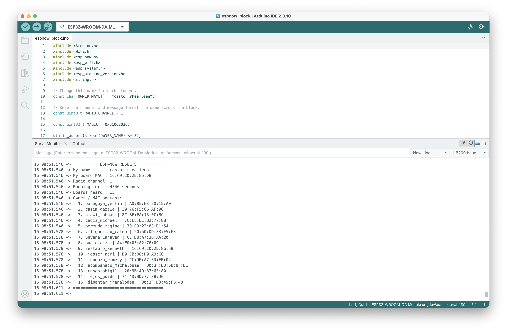

# ESP-NOW Results

| Item | Result |
| :--- | :--- |
| Name (lastname_firstname) | castor_rhea_leen |
| Board | ESP32-WROOM-32 |
| Board MAC address | `1C:69:20:2B:85:D8` |
| Number of boards heard | 15 other boards |
| MAC addresses heard | Listed below |
| Block | B186 |
| Date and time of the window | November 11, 2026, 2:00–5:00 PM (Philippine time, UTC+8) |
| Radio channel | 1 |

## Boards heard

The addresses below match the Serial Monitor output. The count excludes this board.

| No. | Name shown in Serial Monitor | MAC address |
| :--- | :--- | :--- |
| 1 | paraguya_yestin | `A0:85:E3:E0:15:A0` |
| 2 | casim_gazawe | `30:76:F5:C6:AF:9C` |
| 3 | alawi_rabbah | `8C:BF:EA:18:0C:BC` |
| 4 | cadiz_michael | `7C:E8:B1:B2:77:88` |
| 5 | bermudo_regine | `30:C9:22:03:D1:54` |
| 6 | viliganilao_caleb | `20:50:0D:33:F5:F8` |
| 7 | Shyane_Canayan | `CC:DB:A7:3D:AA:20` |
| 8 | buale_aiza | `A4:F0:0F:82:76:0C` |
| 9 | restauro_kenneth | `1C:69:20:2B:86:58` |
| 10 | jesser_neri | `B0:CB:D8:D0:A9:CC` |
| 11 | mendoza_emmery | `CC:DB:A7:3D:EB:04` |
| 12 | acompanado_michelouie | `B0:3F:D3:5B:BF:BC` |
| 13 | casas_abigil | `20:9B:A9:87:63:80` |
| 14 | mejos_guido | `74:4D:BD:77:38:D0` |
| 15 | dipantar_jhanaloden | `B0:3F:D3:49:FB:48` |

## Serial Monitor screenshot

The screenshot shows 15 boards heard at 4:08:51 PM, after 4,346 seconds of runtime.

## Screen recording

[Watch the Serial Monitor recording](castor_serialmonitor.mp4)

Recorded at 4:12 PM during the same window. The saved recording is 27.65 seconds long; the activity requests 30 seconds.
